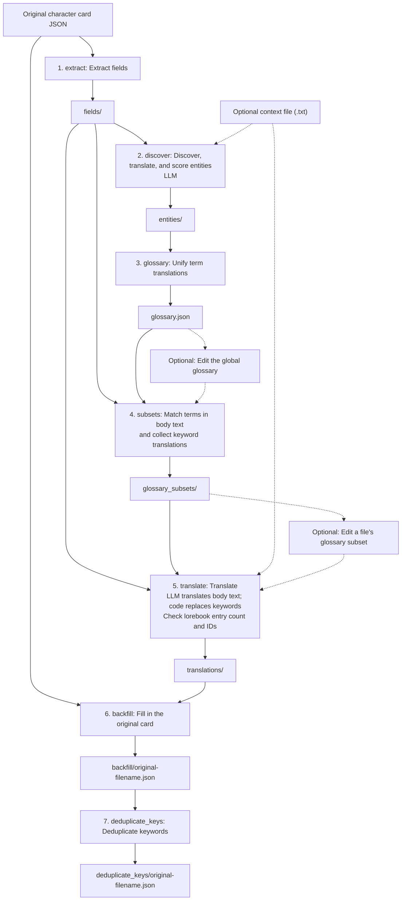

[简体中文](README.md) | [English](README.en.md)

# SillyTavern Character Card Translator

## Introduction

Translate SillyTavern V2-style JSON character cards into your chosen language through an OpenAI-compatible API, while preserving other fields and extensions.

- **Languages and models**: Choose any source and target language, and connect to a local or remote OpenAI-compatible API.
- **Chunked translation**: Split lorebook entries into chunks by entry count; process each greeting separately.
- **Visible progress and resumable runs**: Follow stage and file progress in the terminal. Each stage saves JSON artifacts that can be reused after an interruption.
- **Editable glossary**: Extract terms automatically, keep translations consistent, and add, remove, or edit entries manually.
- **Consistent lorebook keywords**: Use a shared glossary for body text and `keys`/`secondary_keys` to reduce trigger failures caused by inconsistent translations. Terms and keywords can also be kept in their original language.
- **Custom context**: Supply a text file with setting details and style guidance.

PNG cards, V1/V3 cards, and lorebook keywords in `/pattern/flags` form are currently unsupported.

## Usage

### Installation

Download and extract the entire `st-character-card-translate-windows-x64.zip` archive. Python is not required. Portable builds currently support Windows x64; Linux users can [install from source](#install-from-source).

Open PowerShell in the extracted directory to run the commands below.

### Configuration

Edit `config.toml` beside the executable, using your API service's URL, API key, and model name:

```toml
[openai]
base_url = "http://127.0.0.1:8317/v1"
api_key = "your-api-key"
model = "your-model-name"
max_retries = 2
```

The API service and model must support Chat Completions with strict JSON Schema structured output. Use `--config-file PATH` to supply a TOML file that overrides individual settings.

### CLI arguments

Run `.\st-character-card-translate.exe --help` to view help.

| Argument | Default | Purpose |
| --- | --- | --- |
| `INPUT_JSON` | Required | Path to the original character card |
| `--source-lang LANG` | Required | Source language |
| `--target-lang LANG` | `zh-Hans` | Target language |
| `--output-dir PATH` | Current directory | Output parent directory; a task directory is created inside it |
| `--background PATH` | None | UTF-8 text file with context and style guidance |
| `--config-file PATH` | None | Custom TOML configuration |
| `--input-encoding NAME` | `utf-8-sig` | Input card encoding |
| `--chunk-size N` | `10` | Maximum lorebook entries per chunk; a positive integer |
| `--no-translate-glossary` | Off | Keep glossary terms and lorebook keywords in their original language |
| `--delay-between-requests SECONDS` | `0` | Seconds to wait before each model request |
| `--from-stage NAME` | `extract` | First stage to run, inclusive |
| `--to-stage NAME` | `deduplicate_keys` | Last stage to run, inclusive |

Languages use BCP 47 tags, such as `en` (English), `ja` (Japanese), `zh-Hans` (Simplified Chinese), and `zh-Hant` (Traditional Chinese). Stage names appear in the [flowchart](#how-it-works) below; running a stage range requires the relevant upstream artifacts.

### Typical workflow

First, translate an English card into Simplified Chinese:

```powershell
.\st-character-card-translate.exe "C:\cards\card.json" --source-lang en --output-dir outputs
```

The final card is saved to `outputs/card__en_to_zh-Hans/deduplicate_keys/card.json`.

If names or terminology need adjustment, open `outputs/card__en_to_zh-Hans/glossary.json`. Each entry maps a source term to its translation; add, remove, or edit entries as needed. Keep entries required by lorebook keywords.

After editing, delete these four directories from the task directory: `glossary_subsets/`, `translations/`, `backfill/`, and `deduplicate_keys/`.

Keep `fields/`, `entities/`, and your edited `glossary.json`, then rerun the original command above. The tool reuses these artifacts and regenerates the glossary subsets, translations, and final card.

After an interrupted run, rerun the same command to resume. Keep the input, languages, context, output directory, and other arguments unchanged.

## How it works

The workflow has seven stages. Only entity discovery and body text translation call the model:



Code replaces lorebook keywords using exact glossary lookups. Review the model's term usage and check actual lorebook triggering.

## Development

See [PLAN.md](https://github.com/chansey97/st-character-card-translate/blob/main/PLAN.md) (in Chinese) for implementation details, data formats, and complete resume rules.

### Install from source

Requires Git and Python 3.11 or later. Clone the project:

```console
git clone https://github.com/chansey97/st-character-card-translate.git
cd st-character-card-translate
```

Create and activate a virtual environment for your system:

| System | Create environment | Activate environment |
| --- | --- | --- |
| Windows (PowerShell) | `python -m venv .venv` | `.\.venv\Scripts\Activate.ps1` |
| Linux | `python3 -m venv .venv` | `source .venv/bin/activate` |

Install the development dependencies:

```console
python -m pip install -e ".[dev]"
```

With a source installation, use `st-character-card-translate` in place of `.\st-character-card-translate.exe`. Create a `config.toml` as described under [Configuration](#configuration) and pass `--config-file config.toml` when running the tool.

### Build a portable release

On Windows, complete the source installation above with x64 Python, then run:

```powershell
.\build_portable.bat
```

Build artifacts are saved to `dist/` on success.

### Tests

```console
python -m pytest
python -m pytest tests/live -s
python -m pytest tests/portable
```

By default, pytest runs unit and integration tests without calling an API. `tests/live` calls the configured API and saves artifacts in `test_outputs/live/`. Build the portable package before running `tests/portable`, which checks the extracted application against a local mock service.
