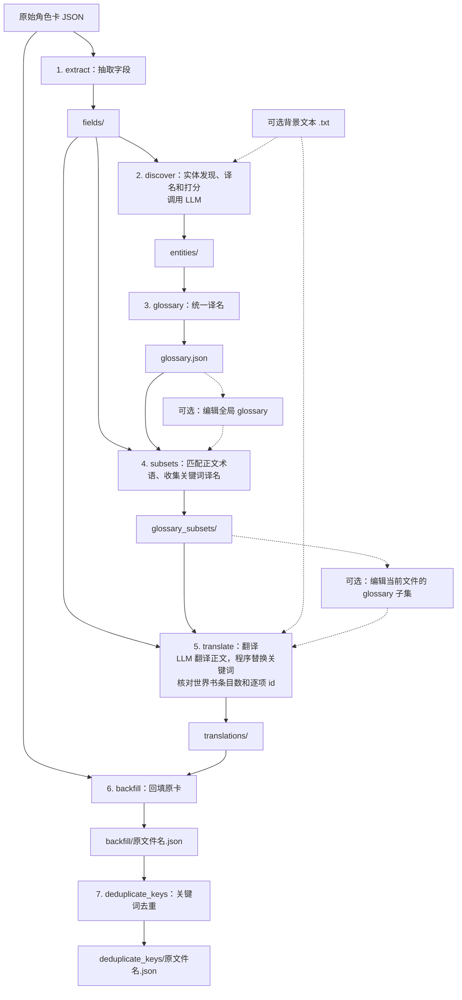

# SillyTavern 角色卡翻译工具

## 介绍

通过 OpenAI 兼容接口，将 SillyTavern V2 风格 JSON 角色卡翻译为指定语言，保留原卡的其他字段和扩展。

- **多语言与自选模型**：支持任意源语言和目标语言，可连接本地或远程的 OpenAI 兼容 API。
- **分片翻译**：世界书按条目数分片，每条开场白独立处理。
- **可观察、可续跑**：终端显示阶段和文件进度，各阶段保存 JSON 中间产物，中断后可复用已有文件继续。
- **可编辑词汇表**：自动提取术语并统一译名，支持手动新增、删除和修改词条。
- **世界书关键词一致性**：正文与 `keys`、`secondary_keys` 使用同一份词汇表，减少译名不一致造成的触发失效；也可保留术语和关键词原文。
- **背景定制**：通过文本文件提供作品背景和文风参考。

暂不支持 PNG、V1、V3 角色卡或 `/pattern/flags` 形式的世界书关键词。

## 用法

### 安装

下载并完整解压 `st-character-card-translate-windows-x64.zip`，无需安装 Python。当前 portable 仅支持 Windows x64；Linux 用户可参考[从源码安装](#从源码安装)。

在解压目录打开 PowerShell，下文命令均在该目录执行。

### 配置

编辑 exe 同目录的 `config.toml`，将 API 地址、密钥和模型改为所用服务的值：

```toml
[openai]
base_url = "http://127.0.0.1:8317/v1"
api_key = "你的 API 密钥"
model = "你的模型名称"
max_retries = 2
```

API 服务和所选模型须支持 Chat Completions 的严格 JSON Schema 结构化输出。也可通过 `--config-file PATH` 指定 TOML 文件，覆盖同名配置项。

### CLI 参数

使用 `.\st-character-card-translate.exe --help` 查看帮助。

| 参数 | 默认值 | 用途 |
| --- | --- | --- |
| `INPUT_JSON` | 必填 | 原始角色卡路径 |
| `--source-lang LANG` | 必填 | 源语言 |
| `--target-lang LANG` | `zh-Hans` | 目标语言 |
| `--output-dir PATH` | 当前目录 | 输出父目录，工具会在其下创建任务目录 |
| `--background PATH` | 无 | UTF-8 背景及文风参考文本 |
| `--config-file PATH` | 无 | 自定义 TOML 配置 |
| `--input-encoding NAME` | `utf-8-sig` | 原卡编码 |
| `--chunk-size N` | `10` | 世界书每片最大条目数，正整数 |
| `--no-translate-glossary` | 关闭 | 保留词汇表所列术语及世界书关键词的原文 |
| `--delay-between-requests SECONDS` | `0` | 每次模型请求前等待的秒数 |
| `--from-stage NAME` | `extract` | 起始阶段，包含该阶段 |
| `--to-stage NAME` | `deduplicate_keys` | 结束阶段，包含该阶段 |

语言使用 BCP 47 标签，例如 `en`（英语）、`ja`（日语）、`zh-Hans`（简体中文）、`zh-Hant`（繁体中文）。阶段名称见下方[流程图](#工作原理)；指定阶段区间时需已有相应上游产物。

### 典型用法

先将英语角色卡翻译为简体中文：

```powershell
.\st-character-card-translate.exe "C:\cards\card.json" --source-lang en --output-dir outputs
```

最终角色卡位于 `outputs/card__en_to_zh-Hans/deduplicate_keys/card.json`。

如果译名不满意，打开 `outputs/card__en_to_zh-Hans/glossary.json`，按“原词 → 译名”的映射增删改词条。世界书关键词对应的词条需保留。

编辑后，删除该任务目录中的 `glossary_subsets/`、`translations/`、`backfill/`、`deduplicate_keys/` 四个目录，保留 `fields/`、`entities/` 和编辑后的 `glossary.json`，再执行上面的原命令。工具会复用保留的中间产物，重新生成词汇表子集、译文和最终角色卡。

任务中断后也可直接执行原命令续跑。续跑时保持输入、语言、背景和输出目录等参数不变。

## 工作原理

流程分为七个阶段，只有实体发现和正文翻译调用模型：



世界书关键词由程序按词汇表精确替换。正文的术语采用及实际触发效果仍需人工检查。

## 开发

实现方案、数据格式和完整续跑规则见 [PLAN.md](https://github.com/chansey97/st-character-card-translate/blob/main/PLAN.md)。

### 从源码安装

需要 Git 和 Python 3.11 或以上版本。克隆项目：

```console
git clone https://github.com/chansey97/st-character-card-translate.git
cd st-character-card-translate
```

按系统创建并激活虚拟环境：

| 系统 | 创建环境 | 激活环境 |
| --- | --- | --- |
| Windows（PowerShell） | `python -m venv .venv` | `.\.venv\Scripts\Activate.ps1` |
| Linux | `python3 -m venv .venv` | `source .venv/bin/activate` |

安装开发依赖：

```console
python -m pip install -e ".[dev]"
```

源码安装后，使用 `st-character-card-translate` 替换上文的 `.\st-character-card-translate.exe`。按[配置](#配置)准备 `config.toml`，运行时加上 `--config-file config.toml`。

### 构建 portable 发行包

在 Windows 上使用 x64 Python 完成上述安装后，运行：

```powershell
.\build_portable.bat
```

构建成功后，产物位于 `dist/`。

### 测试

```console
python -m pytest
python -m pytest tests/live -s
python -m pytest tests/portable
```

默认运行单元和集成测试，不连接 API。`tests/live` 使用配置中的真实 API，产物保存在 `test_outputs/live/`；`tests/portable` 需先构建发行包，使用本地模拟服务验证解压运行。
