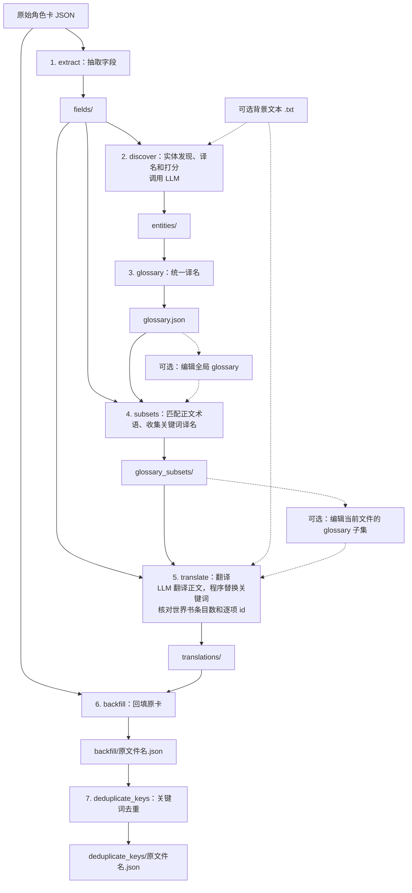

# SillyTavern 角色卡翻译工具

通过 OpenAI Compatible API（兼容 OpenAI Chat Completions 的接口）翻译 V2 风格 JSON 角色卡。七阶段流程依次抽取字段、发现实体、统一译名、生成术语子集、翻译、回填、去重世界书关键词。最终角色卡保留未知字段和扩展。



最终产物是 `deduplicate_keys/` 中的角色卡。

## 安装

需要 Python 3.11 或以上版本：

```powershell
python -m venv .venv
.\.venv\Scripts\Activate.ps1
python -m pip install -e ".[dev]"
```

普通安装使用 `python -m pip install .`。`st-character-card-translate` 和 `python -m st_character_card_translate` 提供相同入口。

## 配置

可连接本地或远程的 OpenAI Compatible API 服务。服务及所选模型须支持 Chat Completions 的严格 JSON Schema 结构化输出（`response_format.type="json_schema"`、`json_schema.strict=true`）。

包内默认配置：

```toml
[openai]
base_url = "http://127.0.0.1:8317/v1"
api_key = "123456"
model = "gemini-3.8-flash-high"
max_retries = 2
```

请根据所用 API 服务，通过 TOML 文件覆盖 `base_url`、`api_key` 和 `model`，分别指定服务地址、密钥和模型。配置逐层加载：包内默认值 → 用户配置 → `--config-file PATH`。用户配置位置是 `platformdirs.user_config_path("st-character-card-translate", appauthor=False) / "config.toml"`，可运行下列命令查看：

```console
python -c "from platformdirs import user_config_path; print(user_config_path('st-character-card-translate', appauthor=False) / 'config.toml')"
```

不存在的用户配置会被跳过；显式指定的文件必须存在。只接受上述四项，每层均独立校验；没有环境变量覆盖层或当前目录自动搜索。`--help` 无需读取配置或连接 API 服务。

## 使用

源语言必填，目标语言默认为简体中文：

```console
st-character-card-translate examples/main_the-shining-stone-3ab47f90d0c6_json.json --source-lang en --output-dir outputs
```

任务目录为 `<输出父目录>/<输入文件名去扩展名>__<源语言>_to_<目标语言>/`。省略 `--output-dir` 时使用当前目录作为父目录。最终角色卡位于任务目录的 `deduplicate_keys/<原文件名>`；`backfill/` 保留去重前的角色卡。

```console
st-character-card-translate card.json --source-lang en --target-lang ja --chunk-size 10 --background background.txt --config-file api.toml --output-dir outputs
st-character-card-translate card.json --source-lang en --to-stage glossary
st-character-card-translate card.json --source-lang en --from-stage subsets
st-character-card-translate card.json --source-lang en --from-stage translate --no-translate-glossary
st-character-card-translate card.json --source-lang en --from-stage backfill
```

| 参数 | 默认值 | 用途 |
| --- | --- | --- |
| `--source-lang LANG` | 必填 | 源语言标签 |
| `--target-lang LANG` | `zh-Hans` | 目标语言标签 |
| `--output-dir PATH` | 当前目录 | 输出父目录，始终追加任务目录 |
| `--background PATH` | 无 | UTF-8 文本背景及文风参考，允许 BOM |
| `--config-file PATH` | 无 | 最高优先级的 TOML 配置 |
| `--input-encoding NAME` | `utf-8-sig` | 原卡编码 |
| `--chunk-size N` | `10` | 世界书每片最大条目数，正整数 |
| `--no-translate-glossary` | 关闭 | 保留子集术语及世界书关键词原文 |
| `--delay-between-requests SECONDS` | `0` | 每次模型请求前等待，包括第一次 |
| `--from-stage NAME` | `extract` | 起始阶段，包含该阶段 |
| `--to-stage NAME` | `deduplicate_keys` | 结束阶段，包含该阶段 |

阶段顺序：`extract → discover → glossary → subsets → translate → backfill → deduplicate_keys`。只运行指定区间，不自动补跑上游。成功退出码为 `0`，参数或配置错误为 `2`，阶段失败为 `1`，错误包含阶段与相关路径。

各阶段在处理文件前立即打印当前文件序号、总数和文件名，包括等待模型响应之前：

```text
[discover] 1/19 data.alternate_greetings_0.json
[discover] 2/19 data.alternate_greetings_1.json (skipped: exists)
[discover] 3/19 data.character_book.description.json
```

序号表示当前处理到的文件，包含跳过项，不表示该文件已经完成。`glossary` 和 `backfill` 的计数包括读入的中间文件及最后写出的结果文件；结果已存在时显示 `1/1` 并标注跳过。没有文件可处理时显示 `0/0 (no files)`。

语言标签只检查非空以及 ASCII 字母、数字和连字符，原样用于目录名和请求。单个开场白始终对应一个文件；分片大小只影响世界书。

## 检查、编辑与续跑

所有阶段均以目标文件存在作为唯一复用条件。已有文件不会被自动覆盖，也不会为了复用而读取校验。使用上游数据时才检查其内容。发生错误后，已生成的文件保留。

可在 `glossary.json` 中统一修改译名。每个 `glossary_subsets/` 文件固定包含 `glossary`（正文术语）与 `keywords_glossary`（世界书关键词译名），可分别编辑。跨条目的统一改名应修改全局 glossary 后重建下游；两个词典的人工修改不会自动同步。

修改后请手动删除当前任务目录中的相应产物，再保持输入、语言、背景和输出父目录参数一致续跑：

| 修改内容 | 删除的产物 | 续跑阶段 |
| --- | --- | --- |
| 原卡、编码、分片大小、语言 | 全部任务产物，或换输出父目录 | `extract` |
| 背景、模型、实体提示词、fields | entities 及其全部下游 | `discover` |
| entities | glossary 及其全部下游 | `glossary` |
| 全局 glossary | subsets、translations、回填卡、去重卡 | `subsets` |
| 子集结构或生成规则 | subsets、translations、回填卡、去重卡 | `subsets` |
| 某个子集词典 | 同名译文、回填卡、去重卡 | `translate` |
| 术语模式、翻译提示词 | translations、回填卡、去重卡 | `translate` |
| 某个译文文件 | 回填卡、去重卡 | `backfill` |
| 回填卡 | 去重卡 | `deduplicate_keys` |
| 最终卡 | 无 | 保留编辑后的文件 |

目录对应：subsets 指 `glossary_subsets/`，回填卡指 `backfill/`，去重卡指 `deduplicate_keys/`。人工编辑时保持文件名、JSON 结构、世界书条目数量和顺序及原生 id。备选开场白文件名中的序号对应原数组位置。

工具不支持 PNG、V1、V3 或 `/pattern/flags` 形式的世界书关键词。除普通目标字段、每条开场白以及世界书 `keys`、`secondary_keys`、`content`、`comment` 外，其余数据保留，包括世界书 `name`、`id` 和设置。关键词由程序精确替换及稳定去重；正文的术语采用、格式和 SillyTavern 递归触发效果需要人工检查。

## 测试

```console
python -m pytest
python -m pytest tests/live -s
```

默认只运行单元和集成测试，不连接 API。真实测试显式运行，使用相同的默认及用户配置，以两组语言组合发起少量真实请求。输入和输出保存在 `test_outputs/live/<含微秒时间戳>/<case_name>/`，成功和失败均保留并报告路径。检查译文语言、可读性、术语采用，以及宏、标签和格式保留；测试不以固定译文措辞作为断言。

完整数据契约、提示词与验收要求见 [PLAN.md](PLAN.md)。请求采用 [OpenAI Structured Outputs](https://developers.openai.com/api/docs/guides/structured-outputs?api-mode=chat) 的严格 JSON Schema，保持同步、串行、非流式执行。
